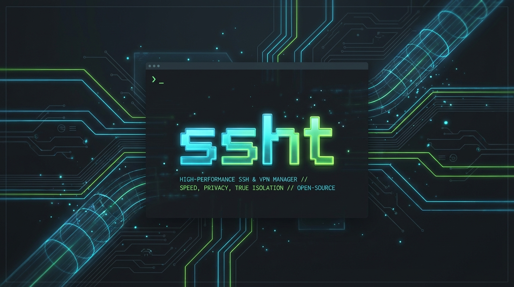

# ssht

[](https://goreportcard.com/report/github.com/akunbeben/ssht)
[](https://opensource.org/licenses/MIT)



ssht is a fast SSH launcher. Save your servers once, then find one with fuzzy search and press Enter to connect. You never need to remember hosts, users, ports, or keys again.

Need a VPN to reach a server? ssht can tunnel just that SSH connection through WireGuard, ShadowSocks, or Trojan, without touching your system network.

## Key Features

### Quick Connect
- **Fuzzy search**: Find servers by name, host, user, tag, or note. Press Enter to connect to the top match.
- **Persistent TUI**: Returns to the server list after an SSH session exits.
- **Auto-import**: Scans your shell history (zsh, bash, fish) on startup to find the servers you already use.
- **Host-key auto-repair**: Detects `REMOTE HOST IDENTIFICATION HAS CHANGED`, removes the stale host key, and retries once.

### Organize Servers
- **Profiles**: Group servers into contexts like `production`, `development`, or `personal`.
- **Move/migrate**: Move servers between profiles from the TUI.
- **Sorting**: Sort by date added, name, or address.

### Multi-Device Sync (Git-based)
- **Git backend**: Sync your profiles across devices using any Git remote (GitHub, GitLab, etc.).
- **Modular config**: Each profile is stored in its own file to minimize merge conflicts.
- **Auto-sync**: Pulls changes on startup and pushes on exit when enabled.
- **Private by design**: Use a private repository to keep your host data safe.

### Isolated VPN per Connection (optional)
Only the SSH connections started by ssht go through the VPN. The rest of your system stays on its normal network.
- **WireGuard without sudo**: Runs in userspace using gVisor netstack. No system tunnel interface or global route changes.
- **Shared WireGuard hub**: Multiple `ssht` instances using the same WireGuard config share one local tunnel, so concurrent tmux panes keep working.
- **Other protocols**: ShadowSocks and Trojan are supported as per-connection proxy dialers.
- **Per-server override**: Set a VPN for one server to override the profile-level VPN.
- **OpenVPN note**: OpenVPN configs are recognized, but isolated OpenVPN dialing is not implemented. Use system OpenVPN separately if needed.

### More Tools
- **SCP transfers**: Press `S` to copy files or directories to and from the selected server, through its VPN when one is set.
- **Key manager**: Generate, list, and copy public keys with `K`.
- **Privacy masking**: Press `*` to hide hostnames, usernames, and VPN configs while streaming or recording. The setting is saved.

## Installation

### Shell One-liner (macOS/Linux)
```bash
curl -sL https://raw.githubusercontent.com/akunbeben/ssht/main/install.sh | sh
```

### Go Installer
```bash
go install github.com/akunbeben/ssht@latest
```

### Quick Build
```bash
make build
make install # Adds ssht to /usr/local/bin
```

### Download Binaries
Download the raw binary for your platform from the [Latest Releases](https://github.com/akunbeben/ssht/releases) page.
- macOS/Linux: chmod +x ssht && mv ssht /usr/local/bin/
- Windows: Add ssht.exe to your PATH.

## TUI Keybindings

| Key | Action |
|---|---|
| j/k, arrows | Navigate list |
| / | Fuzzy search (Enter connects to the top match) |
| Enter | Connect to server |
| Ctrl+K or : | Action palette |
| S | SCP transfer to/from server |
| * | Toggle privacy masking |
| o / O | Change sort (date added, name, address) / Reverse sort |
| p | Switch Profile |
| a / c / e / d | Add / Copy / Edit / Delete server |
| m | Move server between profiles |
| v | Configure profile VPN |
| V | Toggle system-wide VPN |
| K | Pubkey Manager |
| ? | Help Overlay |
| q / Esc | Quit |

## Configuration & Sync

Settings are stored in `~/.ssht/`. Global settings live in `config.json`; each profile is stored separately in `profiles/{name}.json` to reduce Git merge conflicts.

### Multi-Device Synchronization
1. **Setup**: Create a private Git repository and link it:
   ```bash
   ssht sync setup git@github.com:username/my-ssht-config.git
   ```
2. **Push/Pull**: 
   ```bash
   ssht sync push  # Manual push
   ssht sync pull  # Manual pull
   ```
   Note: ssht automatically pulls on startup and pushes on exit when sync is enabled.

### VPN Configurations
ssht supports profile-level VPN config and per-server overrides. Press `v` in the TUI to configure the profile VPN, or set a server-specific VPN while adding/editing a server.

#### Supported VPN config values
- **WireGuard**: path to a `.conf` file, for example `~/vpn/wg0.conf`. Concurrent sessions using the same config share one local userspace hub.
- **ShadowSocks**: `ss://method:password@host:port`
- **Trojan**: `trojan://password@host:port?sni=server_name&allowInsecure=1`
- **OpenVPN**: path to `.ovpn` for system-level use; isolated OpenVPN ProxyCommand dialing is not currently implemented.

#### How isolated WireGuard works
When you connect to a server with a WireGuard VPN configured, ssht launches `ssh` with a hidden `ProxyCommand`. That proxy talks to a local hidden `ssht vpn-hub` process for the WireGuard config. The hub owns one userspace WireGuard device and opens TCP streams through it for each SSH session. System traffic is unaffected.

### SCP Transfers
Select a server and press `S`. Choose `Download` or `Upload`, then enter the remote and local paths. SCP uses the selected server's key, port, and isolated profile/server VPN automatically; the system-wide VPN does not need to be enabled.

### Other Commands
```bash
# Check version and build info
ssht version

# Use a specific profile
ssht -p work

# Import manual history file
ssht server import-history --file ~/.zsh_history
```

## Development

```bash
make build   # Build with symbols stripped for small binary size
make run     # Build and launch immediately
make fmt     # Format source code
```

## Platform Support
- macOS: Native (Apple Silicon & Intel)
- Linux: Native
- Windows: Full support (uses Windows OpenSSH)

## License
This project is licensed under the [MIT License](LICENSE).

---
Built using Bubbletea, gVisor, and WireGuard.
